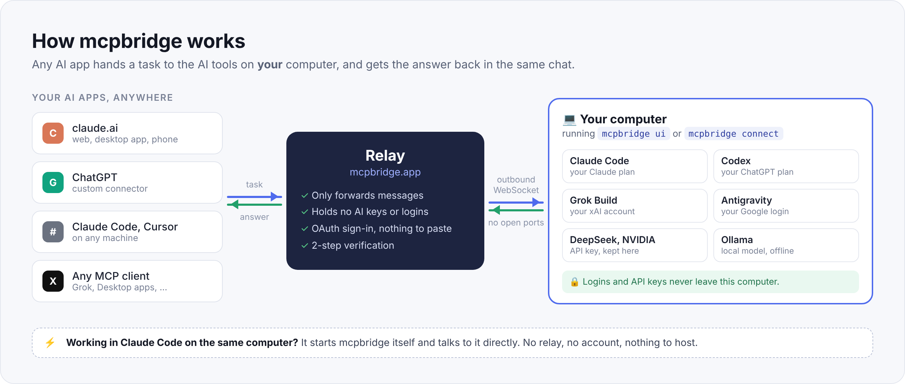
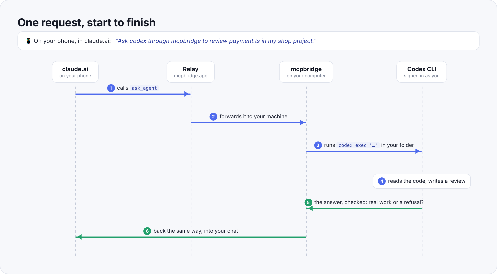
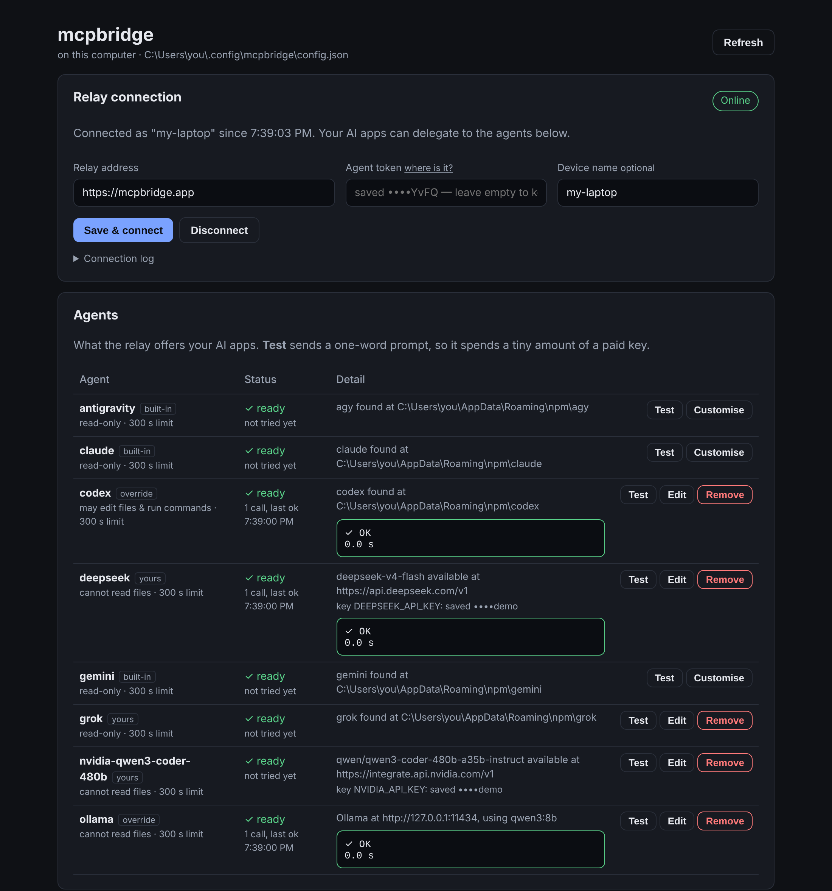
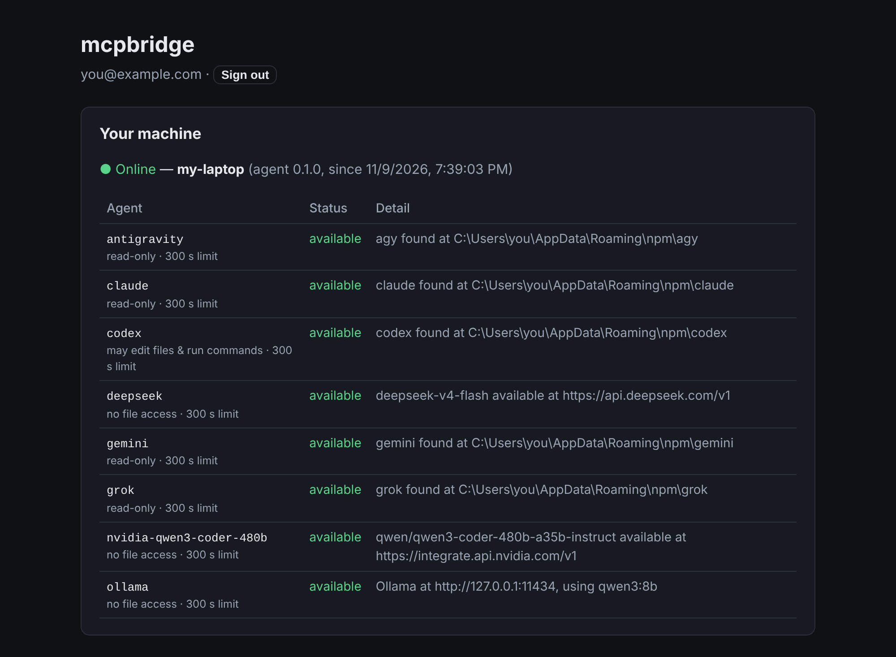

<div align="center">

# mcpbridge

**Let any AI app hand work to the AI tools on your own computer.**

[](https://www.npmjs.com/package/@mcpbridge/cli)
[](https://github.com/szeeshan896/mcpbridge/actions/workflows/ci.yml)
[](LICENSE)

[Quick start](#quick-start) · [How it works](#how-it-works) · [Control panel](#the-control-panel) · [Agents](#agents-you-can-use) · [Safety](#safety) · [Reference](#reference)

</div>



You are chatting with Claude on your phone. Your laptop at home has Codex, Claude Code and
Grok signed in, each on a plan you already pay for. With mcpbridge you can say:

> Ask codex through mcpbridge to review `payment.ts` in my shop project.

Claude passes the task to your laptop. Codex runs there, reads the real files, and its
review comes back into the same chat. **One message, work done.**

- **Use the plans you already pay for.** mcpbridge runs the AI command-line tools that are
  signed in on your computer. No new subscription and no API key needed for them.
- **No keys on any server.** Logins and API keys stay on your computer. The relay only
  passes messages along, so a breach there leaks no AI credentials.
- **Works from anywhere.** claude.ai on the web, the desktop app and your phone, ChatGPT,
  Claude Code, Cursor, or any app that speaks [MCP](https://modelcontextprotocol.io).
- **A second opinion on tap.** Have one AI check another's work, or pick the model best at
  the task: a free NVIDIA coding model, DeepSeek, a local Ollama model that never touches
  the internet.
- **No terminal needed.** A control panel in your browser adds agents, keys and the
  connection, and tests each agent with one click.

## Quick start

You need **[Node.js 22 or newer](https://nodejs.org)** on the computer where your AI
tools are installed. Check with `node --version`.

### A. From claude.ai, your phone, ChatGPT and other apps

1. **Create an account** at **[mcpbridge.app](https://mcpbridge.app)**. On the dashboard,
   generate an **agent token**.
2. **Start the control panel** on your computer:

   ```bash
   npx -y @mcpbridge/cli ui
   ```

   It opens in your browser. Paste the agent token under **Relay connection**, then press
   **Save & connect**. The panel turns **Online**. Keep that window open (you can minimise
   it); while it runs, your agents are reachable.
3. **Add the connector in claude.ai.** Open **Customize → Connectors → Add custom
   connector**, name it `mcpbridge`, and use `https://mcpbridge.app/mcp` as the URL. Press
   **Connect**, sign in, and press **Allow**. Nothing to paste. The same connector then
   works in the Claude desktop app and on your phone.
4. **Ask.** In any chat, switch the mcpbridge connector on (**+ → Connectors**) and say
   *"list my mcpbridge agents"*, then *"ask codex to …"*.

The dashboard shows the exact setup lines for Claude Code, Claude Desktop and Cursor, with
your own address filled in.

### B. Only Claude Code, on the same computer

You don't need an account or the relay. Claude Code starts mcpbridge itself:

```bash
# macOS / Linux
claude mcp add -s user mcpbridge -- npx -y @mcpbridge/cli

# Windows (PowerShell or cmd)
claude mcp add -s user mcpbridge -- cmd /c npx -y @mcpbridge/cli
```

Then, in Claude Code: *"ask gemini through mcpbridge to review the caching layer in this
module"*. `-s user` makes it available in every folder, not just the current one.

### Install it for good (optional)

`npx` fetches the latest version each time. To install once instead:

```bash
npm install -g @mcpbridge/cli
mcpbridge ui              # the control panel
mcpbridge --agents        # which agents are ready on this computer
```

## How it works



1. Your AI app calls mcpbridge's `ask_agent` tool. It names an agent (say `codex`), writes a
   self-contained task, and can pass a folder on your computer.
2. The relay at mcpbridge.app forwards the call over a WebSocket that **your computer**
   opened. Nothing on your computer listens for connections, so no ports to open and no
   firewall rules.
3. mcpbridge looks the agent up in **your** configuration and runs it, e.g.
   `codex exec "<task>"` in that folder. The task is passed as a single argument with no
   shell involved, so text in a prompt can never become a command.
4. The agent works the way it always does, signed in as you.
5. mcpbridge **checks the answer** before calling it a success. An agent that exits normally
   but only says *"I couldn't read the files"*, or stops after *"I'll start by reading
   payment.ts"*, comes back as a failure that says why. A usage limit or an expired
   sign-in is remembered, so the next call is told straight away instead of waiting.
6. The answer travels back the same way into your chat.

Close the laptop and the dashboard shows **offline**. That is the point, not a
limitation: the work happens where your logins are, which is why the server needs none.

## The control panel

```bash
npx -y @mcpbridge/cli ui        # or: mcpbridge ui
```



A page on your own computer (`http://127.0.0.1:8809`) that does everything this README does
with commands:

- **Connect to the relay.** Paste the agent token once. The page keeps the computer online
  while it is open, reconnects by itself the next time you open it, and sends a newly added
  agent to the relay straight away.
- **Add an agent from a preset.** NVIDIA (free tier), DeepSeek, Grok, OpenRouter, Groq,
  Mistral, Ollama, or any OpenAI-compatible service or command-line tool. Paste the key,
  press **List models**, pick one and save. To keep several models from one provider, tick
  them under **Add several models at once**. Each becomes its own agent, named after its
  model (`nvidia-qwen3-coder-480b`).
- **Test** any agent with a one-word prompt and see the answer or the exact error.
- **Allow edits or commands** per agent (see [Safety](#safety)).

**On Windows**, if you cloned the repository, double-click `start-ui.cmd`. Put a shortcut to
it on your desktop to start mcpbridge with one click.

Keys and the agent token are saved in `~/.config/mcpbridge/secrets.json` on your computer.
They are never written to `config.json` and never sent to the relay. The page answers only on
127.0.0.1, and only to the browser that opened the link it printed.

## The dashboard



[mcpbridge.app](https://mcpbridge.app) shows whether your computer is online and which agents
it offers. It is also where you manage tokens, turn on 2-step verification, and see and
disconnect the apps you have allowed.

## Agents you can use

| Agent | What it is | Needs |
|---|---|---|
| `claude` | Claude Code | `claude` installed and signed in |
| `codex` | OpenAI Codex CLI | `codex` installed and signed in |
| `grok` | Grok Build CLI | `grok` installed and signed in |
| `antigravity` | Google's Antigravity CLI (`agy`), Gemini models | `agy` installed and signed in |
| `gemini` | Gemini CLI | `gemini` installed and signed in |
| `ollama` | a model running locally in [Ollama](https://ollama.com) | Ollama and one pulled model. No account, works offline |
| anything else | DeepSeek, NVIDIA, xAI API, OpenRouter, Groq, Mistral, LM Studio, … | an API key, added in the control panel |

The first six are built in: install the tool, sign in once in a terminal, and it shows up.
Anything not installed is listed as unavailable, never silently broken. Check from a
terminal:

```bash
npx -y @mcpbridge/cli --agents
```

```
✓ claude     claude found on PATH
✓ codex      codex found on PATH
✗ gemini     gemini is not on PATH — install it or fix the command
✓ ollama     Ollama at http://127.0.0.1:11434, using qwen3:latest
```

Using these tools removes the key, not the quota: each one still spends its own plan's
limits.

## Tools your AI app gets

| Tool | What it does |
|---|---|
| `list_agents` | which agents exist, whether each is ready, what each may do, and whether your computer is online |
| `ask_agent` | give one agent a task, wait, get the answer |
| `start_task` | the same, but returns an id at once, for work longer than the app will wait |
| `get_task` | check on a started task: queued, running (with the output so far), or finished |

The agent you delegate to starts fresh. It cannot see your chat, so the calling AI writes a
complete task and passes `workingDirectory` when it is about code.

Every answer says honestly how it went:

- **`succeeded`** is true only if the agent actually did the work, not just because its
  program exited normally.
- **`status`** in `list_agents` is `ready`, `unavailable`, `quota-exhausted`,
  `sign-in-failed` or `directory-not-trusted`, with the last error and, when the agent
  named one, when to retry. A limit is remembered for an hour, a failed sign-in for six,
  and any success clears it.
- **`writesFiles`** and **`runsCommands`** say what the agent is allowed to do, so the
  calling AI hands file-changing work only to an agent that can do it.
- **`diagnostics`** is short and to the point. `notes` carries what you should know about a
  success, such as tokens spent or an answer cut short.
- On a **timeout**, whatever the agent had written so far comes back, marked incomplete.
- **Tasks queue.** Two delegations run at once by default. The rest wait their turn, and
  `get_task` says where they are in the queue.

## Safety

mcpbridge runs programs on your computer for apps on the internet, so it is careful by
default.

**Agents are read-only until you allow more.** Every agent starts unable to change files
or run commands. In the control panel, press **Edit** (or **Customise** for a built-in)
and tick what it may do. mcpbridge turns that into the tool's own flags:

| CLI | Change files | Run commands |
|---|---|---|
| claude | `--permission-mode acceptEdits` | `--allowedTools Bash` |
| codex | `--sandbox workspace-write` (one switch for both; still no network) | same |
| grok | `--always-approve` (all or nothing) | same |
| gemini | `--approval-mode auto_edit` | `--approval-mode yolo` |
| agy (Antigravity) | `--mode accept-edits` | `--dangerously-skip-permissions` (allows edits too) |

Allow only what you are happy for every app connected to your account to do on your
computer. Some tools can't even read files without approval when no one is there to give
it: Grok Build, for one, reads with shell commands. Such an agent needs **Change files**
ticked before it can review code.

**Commands come only from your configuration.** A tool call can name an agent, never a
command. The prompt reaches the program as one argument with no shell, so `;`, `&&` and
backticks in a prompt arrive as plain text. A test checks exactly that.

**The relay holds no AI credentials.** It stores accounts, password hashes and token
hashes, never an API key or a CLI login. Tokens are shown once. claude.ai and Claude Code
sign in through OAuth with PKCE, and every app you allow is listed on the dashboard, where
you can disconnect it. 2-step verification with an authenticator app is available.

**Local servers stay local.** The control panel and the optional HTTP mode listen on
127.0.0.1 only, and refuse requests from other websites.

## Reference

### Commands

```
mcpbridge                     MCP server over stdio (what Claude Code starts)
mcpbridge ui [--port N]       the control panel in your browser
mcpbridge connect             stay connected to the relay (uses the saved token,
  [--relay URL --token T]     or pass them here)
mcpbridge --agents            which agents are ready here
mcpbridge --ask <agent> "…"   delegate once from the terminal, to test an agent
mcpbridge --http [port]       one shared HTTP server on 127.0.0.1 (default 8808)
mcpbridge --example-config    print a starter config
```

### Configuration

Everything the control panel does is saved in `~/.config/mcpbridge/config.json` (set
`MCPBRIDGE_CONFIG` to use another file). You can also write it by hand. An entry replaces the
built-in agent of the same name.

```json
{
  "maxConcurrent": 2,
  "agents": {
    "codex": {
      "command": ["codex", "exec", "--skip-git-repo-check", "{prompt}"],
      "allow": { "edits": true, "commands": true },
      "timeoutMs": 600000
    },
    "deepseek": {
      "type": "openai",
      "baseUrl": "https://api.deepseek.com/v1",
      "model": "<a model id: List models in the control panel shows them>",
      "apiKeyEnv": "DEEPSEEK_API_KEY"
    },
    "local": { "type": "ollama", "model": "qwen3:latest" }
  }
}
```

| Field | Meaning |
|---|---|
| `command` | the program and its arguments. `{prompt}` is replaced by the task, as one argument |
| `promptVia` | `"argv"` (default) or `"stdin"`. Use stdin for long prompts: Windows limits an argument to about 32 KB |
| `allow` | `{ "edits": true, "commands": true, "trustDirectory": true }`, the same switches as the control panel |
| `capabilities` | for a CLI mcpbridge doesn't know: declare `{ "writesFiles": true, "runsCommands": true }` yourself |
| `env` | extra environment variables for that agent |
| `timeoutMs` | how long one call may run (default 5 minutes) |
| `type: "openai"` | any service with `POST /v1/chat/completions`: `baseUrl`, `model`, `apiKeyEnv` |
| `type: "ollama"` | a local Ollama model: `model`, optional `baseUrl` |
| `maxConcurrent` | how many delegations run at once (default 2) |

`apiKeyEnv` is the **name** of an environment variable, not the key, so a config file can be
shared without leaking anything. Keys saved in the control panel go to `secrets.json` and are
loaded into that variable. A variable you export yourself still wins.

### Troubleshooting

| You see | What to do |
|---|---|
| Panel or dashboard says **offline** | Start `mcpbridge ui` (or `mcpbridge connect`) and keep its window open |
| `sign-in-failed`, *"session expired"* | Run that tool once in a terminal and sign in again |
| `quota-exhausted` | The tool's plan hit its limit. Wait for `retryAt`, or use another agent |
| Agent times out, or says it *needs permission* | It stopped at an approval prompt. Allow edits or commands for it, or ask only for a reading |
| Gemini CLI: `IneligibleTierError` | Google withdrew Gemini CLI for personal accounts. Use the built-in `antigravity` agent, same models, same login |
| `directory-not-trusted` | Tick *Trust the working directory* for that agent, if you trust the folders your apps send it |
| Codex: *not a git repository* | Point it at a git repository, or add `--skip-git-repo-check` to its command |
| Claude Code doesn't see the tools | Add it with `-s user`, then restart Claude Code. Check with `claude mcp list` |

**Windows:** npm-installed CLIs are `.cmd` files, which Node can't run without a shell, and a
prompt must never go through a shell. mcpbridge reads the `.cmd` file and runs the real
program it points to, so `claude`, `codex` and the rest work as they are.

### Run your own relay

mcpbridge.app is one instance of the relay in [`relay/`](relay/README.md). You can host your
own: it is one Docker image with a SQLite database, and deploys to Railway, Fly.io or any
VPS. Accounts use email or phone, a password or Google, with optional 2-step verification.

## Development

```bash
git clone https://github.com/szeeshan896/mcpbridge.git
cd mcpbridge
npm install       # also builds dist/
npm test          # typecheck and tests
npm start         # the stdio server, from source
cd relay && npm install && npm test
```

```
src/agents/    running each kind of agent: cli.ts, openai.ts, ollama.ts; judging an
               answer (outcome.ts); remembered failures (health.ts); permission flags
               (permissions.ts); Windows .cmd shims (shim.ts)
src/ui/        the control panel
src/connect.ts the outbound connection to a relay; src/protocol.ts its messages
src/tools.ts   the four tools, shared by the local server and the relay path
src/tasks.ts   background tasks and their queue
relay/         the hosted relay: accounts, OAuth, tokens, 2FA, dashboard, forwarding
test/fixtures/ a stand-in agent CLI, so the suite runs on Windows, macOS and Linux
```

## License

[MIT](LICENSE) © Syed Zeeshan Ali
